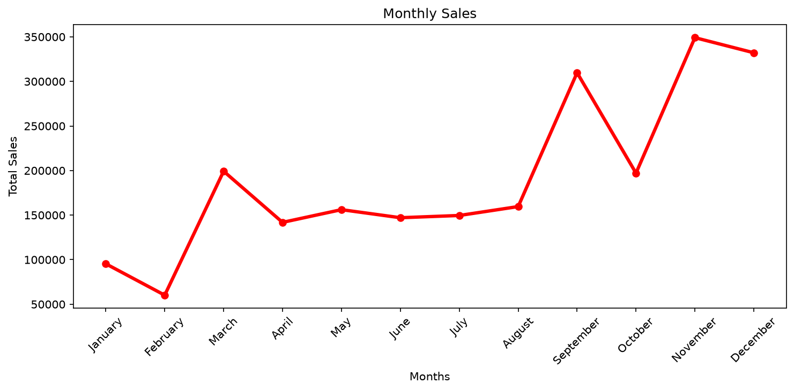
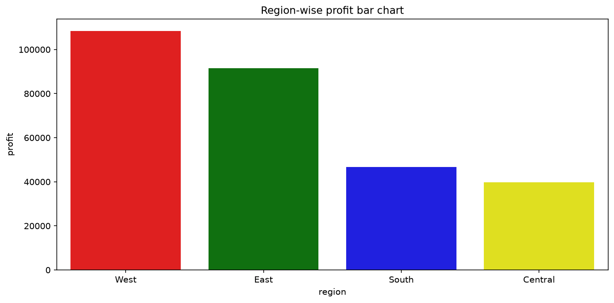
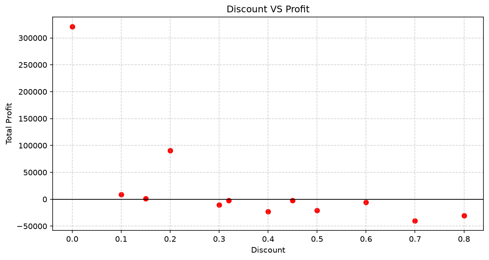
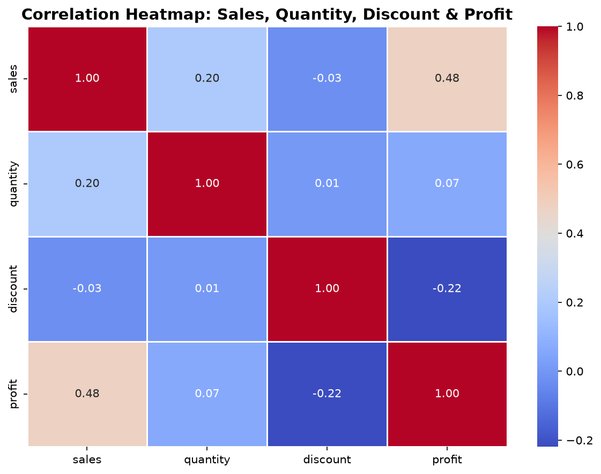

# Superstore Sales Analysis

Exploratory analysis of a retail sales dataset using Python (Pandas, NumPy, Matplotlib, Seaborn) to find what drives sales and profit and where money is being lost.

## Problem
Which regions, products and discount levels help or hurt profit, and what should the business change?

## Dataset
- Superstore sales data (Kaggle), 9,994 rows and 21 columns, 2011 to 2014
- No missing values or duplicates; 1,871 rows have negative profit (kept as real losses)

## Steps
1. **Understand the data:** shape, data types, summary, unique values
2. **Clean:** converted dates (dd-mm-yyyy), checked duplicates, missing and invalid values, renamed columns
3. **Feature engineering:** order year and month, shipping days, profit margin, loss flag, discount categories
4. **Analysis:** KPIs, yearly and monthly trends, region, category, product, customer and discount analysis
5. **Visualization:** charts for trends, region, discount and correlation
6. **Insights and recommendations**

## Key Findings
- Sales 2.30M, profit 286K, margin 12.47% across 5,009 orders
- Sales grew from 484K (2011) to 734K (2014); margin fell from 13.43% to 12.74% in 2014
- Sales peak in Nov, Dec and Sep (349K, 332K, 310K)
- Orders with no discount earn +66.9 profit on average; above 20% discount they lose money (-109.5 and -89.4)
- Tables (-17.7K) and Bookcases (-3.5K) lose money; Central Furniture is the only loss-making region and category (-2,871)
- Texas, Ohio and Pennsylvania are the worst states (-25.7K, -17.0K, -15.6K)

## Recommendations
1. Cap discounts at 20%
2. Reduce discounts on Furniture in the Central region (average discount 29.7%)
3. Prepare stock for Sep, Nov and Dec without extra discounts
4. Track margin along with sales

## Charts

## Tools
Python, Pandas, NumPy, Matplotlib, Seaborn, Jupyter Notebook, Git, GitHub